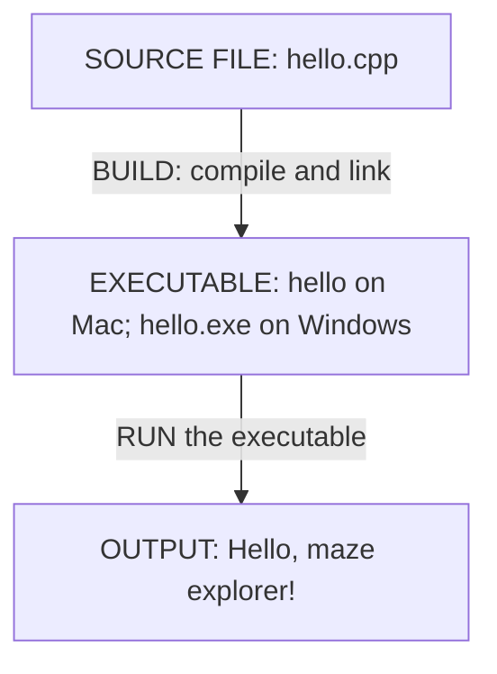
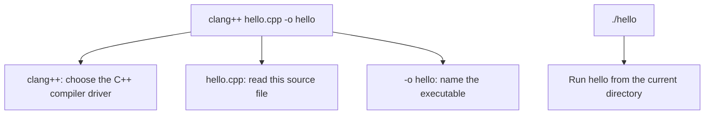
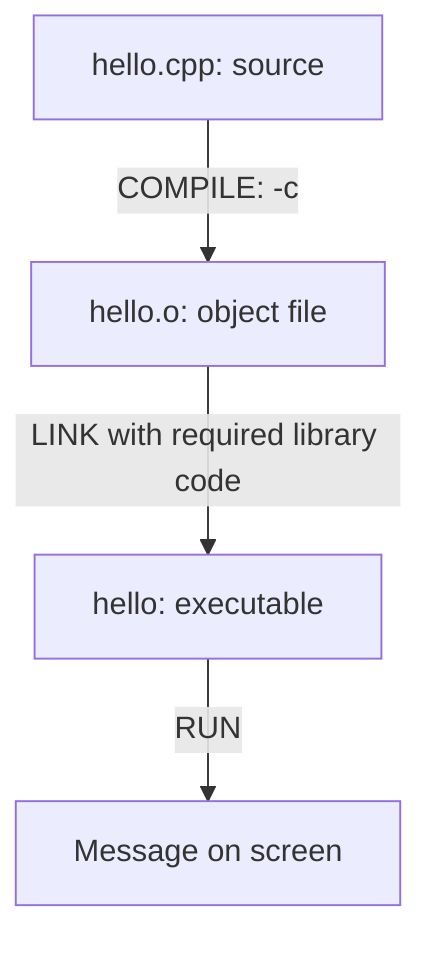

# 00 — Compile and run a C++ program

**For:** Nathan with an adult. **When:** during the learning session.
**Purpose:** learn how source code becomes a program and practise building/running it.

**Adult: before the session**, complete [ADULT-SETUP.md](ADULT-SETUP.md) once to install and verify
the tools. Then return here. **Nathan: start below; the installation guide is not
part of today's lesson.**

**Mission:** turn a supplied C++ source file into a runnable program and show its
message on screen. No programming knowledge is assumed. Allow 20–30 minutes after
the adult has installed and verified the compiler.

Geany is the editor; clang++, g++, or cl is the compiler driver. Use the toolchain
already prepared for this computer. All of today's explanations and exercises are
in this LESSON.md; you do not need to switch back to ADULT-SETUP.md.

## Before we begin: how a game becomes a program

Summary of the supplied transcript from [the introductory C++ game tutorial](https://www.youtube.com/watch?v=luuyjjOxnUI).

### From text to a running game

A game is a program. We write its instructions as **source code**, then use a
compiler and linker to turn that text into an **executable** the computer can run.
On Windows, this is commonly a .exe file; on Mac, our executable does not need that
extension. Writing or saving text alone does not create a runnable game.

### The three jobs in a game loop

A real-time game repeats these jobs while it is running:

1. **Input:** read what the player does, such as pressing a movement key.
2. **Simulation:** update the game world, including movement, enemies, bullets and
   collisions. For our maze, this includes checking whether a wall blocks a move.
3. **Rendering:** present the updated world to the player, with graphics and sound
   as appropriate. Our first maze will use text before we add a graphical view.

Think: **read input → update the world → show the result → repeat**. Repeating
quickly lets the player see the result of their actions almost immediately. Today's
greeting program prints once and exits; we will build towards a game loop later.

### What sits underneath the game?

Our game uses software layers to work with the computer's hardware:

- **Hardware:** the CPU executes instructions; the GPU helps produce graphics.
- **Operating system and drivers:** provide access to the screen, sound, input,
  files and devices.
- **Platform-specific code:** connects our program to facilities on Windows, Mac
  or another platform.
- **Reusable game systems:** handle jobs such as drawing, physics, maths, loading
  assets and managing game objects. Platform-independent parts can be reused
  across platforms.
- **Gameplay code:** defines this game's particular rules, weapons, power-ups or
  puzzles.

A **game engine** is a collection of reusable systems that gameplay code can use.
The tutorial proposes building a small engine to learn how those systems fit
together. In this course, we will build our own maze rules and rendering logic,
then use raylib for graphics and input in later lessons. A small game lets us learn
one system at a time.

### What should work by the end of lesson 0?

The tutorial finishes by installing a C++ toolchain and building a “Hello, world”
program in Visual Studio on Windows. It also introduces debugging: stepping through
a program to inspect what happens as it executes.

Our equivalent goal is to **build and run the supplied greeting program** using
the tools the adult has prepared. Follow the course commands below; installation
belongs in [ADULT-SETUP.md](ADULT-SETUP.md). We can explore debugger stepping later.

**Say it back:** “The compiler helps turn our source text into a runnable program.
A game repeatedly reads input, updates its world and presents the result.”

## 1. Follow the chart

This is the write → build → run chart from our [visual guide](../VISUAL-GUIDE.md):



Point to each box before typing a command:

- **Source:** text instructions saved in a .cpp file.
- **Build:** translate and connect the instructions and required library code.
- **Executable:** the resulting program that the operating system can run.
- **Run:** execute that program and observe what it does.

Saving is not building, and building is not running. A program can build successfully
without having been run yet.

## 2. Open the supplied source

Open [hello.cpp](hello.cpp) in Geany. Do not type terminal commands inside the source file.

**C++ CODE — already supplied in hello.cpp:**

```cpp
#include <iostream>

int main()
{
    std::cout << "Hello, maze explorer!\n";
    return 0;
}
```

Point to the message in quotes and predict the output. Use the syntax guide below
to understand the supplied lines, then practise building and running.

### Read the C++ syntax

Syntax means the spelling and punctuation the language expects. Read these pieces
with an adult; you do not need to memorise the program before running it.

| Piece | What it means in this program |
| --- | --- |
| `#include <iostream>` | Ask the preprocessor to make declarations from the standard input/output header available |
| `#include` | A preprocessing directive, handled before the main compilation steps; it has no ending semicolon |
| `<iostream>` | The header name between angle brackets; these brackets belong to the include directive |
| `int main()` | Define the main function, where our program's own instructions begin |
| `int` before `main` | The function returns an integer status to the operating system |
| `()` after `main` | This definition declares no parameters; keep both parentheses |
| `{` and `}` | Begin and end the function body: the instructions belonging to `main` |
| `std` | The namespace containing these standard-library names |
| `::` | Scope resolution: find the following name inside `std` |
| `cout` | The standard output stream; in this session, its output appears in the terminal |
| `<<` | Insert the value on its right into the output stream on its left |
| `"Hello, maze explorer!\n"` | A string literal: fixed text inside double quotes |
| `\n` inside the string | An escape sequence requesting a newline; it does not print a backslash and n |
| `;` | End a statement such as an output instruction or `return`; it does not print a newline |
| `return 0;` | Finish `main` with status zero, meaning successful completion |

Read the output statement as “send this greeting and a newline to standard output.”
The quotation marks delimit the text in source code; they are not printed.
A function body ends with `}` here, with no extra semicolon after it.

Spaces and indentation help us read the code. The indentation inside the braces
shows which instructions belong to `main`; the braces establish that grouping.
C++ names are case-sensitive: `main` and `Main` are different names.
If you see `//` in the source, everything after it on that line is a comment for
people to read; it is not an instruction to execute.

**Point and explain:** find the statement ending, the requested output newline,
and the two braces. These three kinds of punctuation have different jobs.

## 3. Find the source file in a terminal

On the adult **Mac**, open Terminal:

```sh
cd "$HOME/repositories/edu/learn-to-program-fps/lessons/00-compile-and-run"
pwd
ls
```

On Nathan's **Windows PC**, open PowerShell. This example assumes the course was
copied to source inside his user folder; substitute the actual path:

```powershell
cd "$HOME\source\learn-to-program-fps\lessons\00-compile-and-run"
Get-Location
Get-ChildItem
```

Both listings should show hello.cpp. If it is missing, correct the directory before
building. A Mac path beginning /Users is not Nathan's Windows path.

## 4. Build, then run

Use **one** of the following platform sections. Only run after a successful build.

### Mac — Clang

**TERMINAL — build:**

```sh
clang++ -std=c++17 -Wall -Wextra -Wpedantic hello.cpp -o hello
```

The compiler may print nothing on success. Look for the new executable:

```sh
ls -l hello
```

**TERMINAL — run:**

```sh
./hello
```

### Windows — GCC after MSYS2 setup

**POWERSHELL — build:**

```powershell
g++ -std=c++17 -Wall -Wextra -Wpedantic hello.cpp -o hello.exe
```

**POWERSHELL — run, only if the build succeeded:**

```powershell
.\hello.exe
```

### Windows alternative — existing MSVC

If the adult prepared MSVC, use its **Developer PowerShell** instead of GCC.
Build:

```powershell
cl /nologo /EHsc /std:c++17 /W4 hello.cpp /Fe:hello.exe
```

Run only after the build succeeds:

```powershell
.\hello.exe
```

**Expected output on either platform:**

```text
Hello, maze explorer!
```

The program ends after printing. That is the intended behaviour.

## 5. Read the command instead of memorising it



Read the actual command as a request to a program:

```sh
clang++ -std=c++17 -Wall -Wextra -Wpedantic hello.cpp -o hello
```

The terminal starts clang++ and passes the remaining words to it as arguments.
Words beginning with a dash are options: they tell the tool how to do its job.

| Part | What we are asking for |
| --- | --- |
| clang++ | Start Clang's C++ driver: the tool that coordinates compiling and linking |
| -std=c++17 | Interpret the source using the C++17 language rules |
| -Wall | Enable a useful group of warnings about suspicious code; despite its name, not every possible warning |
| -Wextra | Enable additional warnings beyond the Wall group |
| -Wpedantic | Request diagnostics for certain uses outside the selected language standard |
| hello.cpp | Read this source file from the current directory |
| -o hello | Write the result to a file named hello; -o takes the following word as its output name |

These options are instructions to the build tool, not lines of C++ to put in
hello.cpp. C++17 is a version of the language, not a different compiler to install.

### What happened after you pressed Enter?

1. **Read and prepare the source.** Clang reads hello.cpp. Preprocessing handles
   directives such as #include <iostream>, making the relevant declarations available.
   Including a header does not mean copying the whole library implementation into
   our source file.
2. **Check and translate.** The compiler checks the source against the selected
   language/type rules and translates it towards machine instructions for the target
   computer. The requested warning groups help report some suspicious constructs.
3. **Produce a compiled piece.** Assembly produces object code for our program.
   This one-command build handles intermediate output for us; it does not normally
   leave a separate hello.o alongside hello.cpp.
4. **Link the program.** The driver invokes the linker to connect the compiled
   piece with startup code and required libraries, including C++ standard-library
   support used by std::cout. Libraries need not all be copied into the executable;
   some are loaded when the program runs.
5. **Write hello.** If the build succeeds, we now have an executable named hello
   in this directory. The source file remains source text. This command does not
   execute the new program.

For the unchanged greeting, a successful build will usually return to the prompt
without printing anything. The greeting appears only after the separate run command:

```sh
./hello
```

The ./ means “in the current directory.” The operating system loads the executable,
its startup code leads to main, and our output instruction prints the greeting.

### Predict the difference

Ask: “What changes if we replace -o hello with -o maze?” The new output file is
named maze, so run ./maze. The greeting is unchanged because its source has not
changed. An older hello file, if present, remains a separate executable.

Ask: “What if we omit the warning options?” They request diagnostics, not gameplay
behaviour. For this valid tiny program, the intended output is unchanged, but we
have asked for fewer warnings. Warnings help us inspect code; a warning-free build
does not prove the game behaves as intended. An error normally prevents a successful
build; a warning alone is not necessarily a failure.

Instructor answer in one sentence: “We asked Clang to build hello.cpp using C++17,
with useful diagnostics, and save the runnable result as hello; we have not run it yet.”

After the one-command build is comfortable, use the more detailed chart:



An object file is a built piece, not normally a program you can run by itself.
The one-command build handles the intermediate stage for us. Splitting the build
into two commands is an optional learning experiment, after the first build works.
On Mac, from this lesson's directory:

```sh
clang++ -std=c++17 -Wall -Wextra -Wpedantic -c hello.cpp -o hello.o
clang++ hello.o -o hello
```

The first command compiles only (-c); the second links. After both succeed, run
./hello. The result should print the same greeting. Return to the one-command
build for ordinary work.

## 6. Practise the workflow

1. Predict the message before running the supplied program.
2. Build it. Point to the source file and the resulting executable.
3. Run it. Compare the output with the prediction.
4. Run it again without rebuilding. The source has not changed, so the same output
   is expected.
5. Ask: “If we edit the source tomorrow, will this old executable change by itself?”
   Predict that another build will be needed. Lesson 01 makes that change.

Keep compilation and execution as separate actions initially so Nathan can explain
which command does which job.

## Checkpoint and instructor answers

Nathan is ready for lesson 01 when he can:

- Find hello.cpp and say that it contains source text.
- Build with the supplied command and identify the executable it produces.
- Run the executable from the terminal and recognise the expected output.
- Explain that editing source requires rebuilding before a new program can be run.

Listen for “save → build → run”, not “Geany runs my text automatically.”
If a build fails, stop and read the first useful error; do not run an older executable
as evidence that the new source works. If the file cannot be found, inspect the
directory rather than changing correct C++ code.

Do not quiz him on every flag or header. Today's understanding is the transformation
from instructions to executable to observable behaviour.

Next: [01 — Run, change, run again](../01-first-program/LESSON.md), where Nathan
changes the game's messages and checks the rebuilt result.
