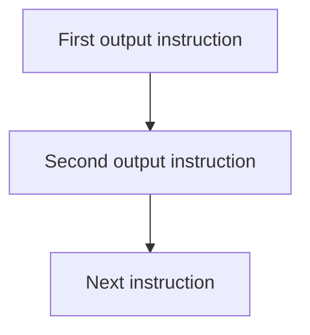

# 02 — Instructions have an order

CLI foundations. Work in short sessions; a lesson is a learning unit, not one uninterrupted talk.

## Before you begin

01: build and run a changed message.

Files: [starter.cpp](starter.cpp) is the runnable starting point.
Keep [target.cpp](target.cpp) for the adult's comparison after the attempt.
The starter runs before any edits; its TRY THIS comment identifies the initial small change.

Use [the common compile/run instructions](../RUN-COMMANDS.md). Copy into Nathan's active
working file rather than overwriting his previous work. Do not ask him to retype
the whole supplied program.

## Follow the picture



## Explain it together

Instructions have an order. For the output statements used here, execution proceeds from the top statement to the next one. The machine does not know that a title “belongs” above a map. We must place the instruction where we want it executed.

Today the maze is just a picture printed as text. It is not yet stored as a world that the player can move through. That distinction will matter later.

### Read the syntax: source lines and screen lines

```cpp
std::cout << "#...#\n";
```

`std::cout` names the standard output stream: `::` finds `cout` inside the `std`
namespace. `<<` inserts the quoted string into that stream. Double quotes delimit
fixed text. `\n` requests an output newline, and `;` ends the statement.

The characters `#` and `.` **inside the quotes** are just text for the player.
They look like walls and floor because we chose those symbols; C++ does not assign
maze rules to them. The `#` at the start of `#include <iostream>` has a different
job: it begins a preprocessing directive outside a string.

Compare these two statements on one source line:

```cpp
std::cout << "Top"; std::cout << "Bottom\n";
```

They print `TopBottom`, followed by a newline. The semicolon separates statements;
we did not request a space or newline between the words. Putting the statements
on separate source lines would still print the same result.

The braces `{` and `}` group the instructions in `int main()`. Within this simple
sequence, each statement runs in order until `return 0;` finishes the program.
Blank lines and indentation make the source easier to read; they do not add output.
`//` starts a comment that lasts to the end of its source line.

**Point and explain:** find a wall character, a statement ending and an output
newline. Then predict the result of removing only one `\n` from a saved copy.

## Worked example — predict before running

Walk a finger down these statements:

```cpp
std::cout << "#####\n";
std::cout << "#...#\n";
std::cout << "#####\n";
std::cout << "Nathan's Maze\n";
```

Prediction: three maze rows appear, followed by the title. A semicolon ends each statement; it does not itself create a new line. The newline is requested by `\n`.

Now imagine moving the last statement above the first. No text changes, but the title appears first. This is a change in execution order.

## Guided practice

1. Number the four output statements 1–4 on paper.
2. Write the predicted screen in that order.
3. Run the starter.
4. Move the title statement above the map statements. Predict the entire output again.
5. Rebuild and compare.
6. Add one output instruction after the map: an instruction to find the exit.

Introduce a deliberate missing semicolon only after the working version has been saved. Restore it after reading the first useful diagnostic.

## Independent challenge

Design a different three-row room. Print it without introducing a loop or variable. Explain which line would need changing to put a door in the bottom wall.

Ask for a prediction before execution. Offer one hint at a time; do not reveal the
target as the answer to the independent challenge.

## Understanding checkpoint

Nathan predicts the result of a new ordering and adds a line in the intended place without being told where to paste it.

Record three short entries: **My rule; My prediction; What happened.** Save a working
copy and stop before introducing another idea if the explanation is still uncertain.

---

## Instructor answers and troubleshooting

The target output begins with Nathan's Maze, then the three unchanged rows. Swapping the identical top and bottom wall statements produces no visible difference; that is a useful reminder that an edit need not change observable behaviour.

Expected misconception: “The computer draws walls before messages.” It simply executes the output instructions in order. Ask for a new prediction after moving one statement.

Do not present repetition as necessary yet. Repeated output is acceptable while sequence is the subject.

### What the comparison target demonstrates

The teacher target moves the title above the existing map; the invitation line remains a student variation.

### Source connection

A: lines 98–115, map row construction; adapt to output statements, not string storage yet.

A/B/C resolve to exact local filenames in [the reference index](../references.md).
These are teacher references, not student reading prerequisites. The supplied lesson
examples are original small teaching programs; they do not copy the reference's
Windows engine infrastructure.

Next: [03 — Remember a value](../03-variables/LESSON.md)

