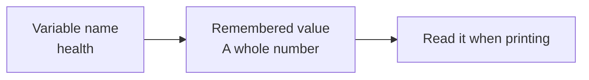

# 03 — Remember a value

CLI foundations. Work in short sessions; a lesson is a learning unit, not one uninterrupted talk.

## Before you begin

02: sequential output.

Files: [starter.cpp](starter.cpp) is the runnable starting point.
Keep [target.cpp](target.cpp) for the adult's comparison after the attempt.
The starter runs before any edits; its TRY THIS comment identifies the initial small change.

Use [the common compile/run instructions](../RUN-COMMANDS.md). Copy into Nathan's active
working file rather than overwriting his previous work. Do not ask him to retype
the whole supplied program.

## Follow the picture



## Explain it together

Sometimes a program must remember a value rather than print the same fixed text forever. A **variable** gives a value a name.

In `int health = 5;`, int means a whole-number value, health is our chosen name, and 5 is the initial value. Read it as “create health and start it at five.” For this lesson, leave the value unchanged after creation.

A label on screen and a variable name are different. The text Health: is just a message. The identifier health tells the program which remembered value to display.

### Read the syntax of a variable and its output

```cpp
int health = 5;
std::cout << "Health: " << health << "\n";
```

| Piece | Meaning |
| --- | --- |
| `int` | The variable's type: a whole number, including zero or negative values within the type's range |
| `health` in the first line | Declare a variable with this chosen name |
| `=` in the declaration | Initialise the new variable with the value on the right |
| `5` | An integer literal: the number five, with no quotes |
| `;` | End the declaration statement |
| `std::cout` | Standard output; `::` finds `cout` in the `std` namespace |
| Each `<<` | Insert the next value into the same output stream |
| `"Health: "` | A string literal containing a label and a final space |
| `health` in the output | Read the variable's current value and output it as a number |
| `"\n"` | A string containing a newline |

Read the second statement as “write the label, then the remembered health value,
then a newline.” Chaining `<<` writes these pieces in order; it adds no automatic
spaces. Output reads `health` without changing it.

Names have no quotes. `"health"` prints a word, `health` reads a variable,
`5` is a number, and `"5"` is text. The last two can look identical when printed,
but only the unquoted `5` is an integer literal for our arithmetic.

Choose names such as `health` or `keys`: no spaces, no starting digit, and no C++
keywords such as `int`. Case matters: `health` and `Health` are different names.
Declare the variable before the instructions that use it. Here it belongs to the
body of `main`, between `{` and `}`. In `int main()`, the same keyword `int`
describes the function's returned status rather than declaring a health variable.

**Point and explain:** which `health` creates the variable and which reads it?
Why is the label quoted while the variable name is not?

## Worked example — predict before running

```cpp
int health = 5;
std::cout << "Health: " << health << "\n";
std::cout << "Remembered health: " << health << "\n";
```

Both instructions use the same variable. Expected values are five and five.

Compare:

```cpp
std::cout << "health\n";
std::cout << health << "\n";
```

The first prints the letters health because they are quoted. The second displays its value because it names the variable.

## Guided practice

1. Make a table with name, value, and meaning: health; 5; the player's remaining health points.
2. Predict both output lines.
3. Change the initial value to 8. Predict both lines before compiling.
4. Run and check that both uses show 8.
5. Print the word health in quotes on a separate line and compare it with the value.

Do not update health midway through the program today; that is the next lesson.

## Independent challenge

Add an integer named keys starting at zero and print a labelled key count. Ask Nathan to explain why it is a number rather than a quoted word.

Ask for a prediction before execution. Offer one hint at a time; do not reveal the
target as the answer to the independent challenge.

## Understanding checkpoint

Nathan can identify a name and its value, explain quoted text versus a variable use, and create one similarly shaped integer declaration.

Record three short entries: **My rule; My prediction; What happened.** Save a working
copy and stop before introducing another idea if the explanation is still uncertain.

---

## Instructor answers and troubleshooting

Both uses of health display the changed initial value. A quoted identifier prints its spelling instead.

If Nathan changes one displayed literal instead of the variable, ask “Which thing is being remembered?” If he expects the text Health: to change when the value changes, distinguish the label from the data.

C++ is case-sensitive: health and Health are different identifiers. Use the naming examples above when diagnosing a misspelled name.

### What the comparison target demonstrates

The teacher target changes health from 5 to 8. The keys declaration is an independent exercise.

### Source connection

A: lines 78–88, named dimensions, position and speed; introduce integers before floats.

A/B/C resolve to exact local filenames in [the reference index](../references.md).
These are teacher references, not student reading prerequisites. The supplied lesson
examples are original small teaching programs; they do not copy the reference's
Windows engine infrastructure.

Next: [04 — A value can change](../04-changing-state/LESSON.md)

