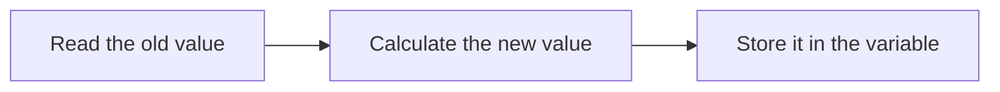

# 04 — A value can change

CLI foundations. Work in short sessions; a lesson is a learning unit, not one uninterrupted talk.

## Before you begin

03: integer variable and displaying it.

Files: [starter.cpp](starter.cpp) is the runnable starting point.
Keep [target.cpp](target.cpp) for the adult's comparison after the attempt.
The starter runs before any edits; its TRY THIS comment identifies the initial small change.

Use [the common compile/run instructions](../RUN-COMMANDS.md). Copy into Nathan's active
working file rather than overwriting his previous work. Do not ask him to retype
the whole supplied program.

## Follow the picture



## Explain it together

A program's remembered values can change while it runs. Its current remembered information is called **state**. Today our state contains a move counter.

Assignment is an instruction to calculate a value and store it. `moves = moves + 1;` is not an algebra claim that a number equals itself plus one. Read the right side using the old value, calculate, then replace the left side's value.

Previously printed output is history. Updating moves does not reach back and rewrite the earlier console line.

### Read the syntax of an update

```cpp
int moves = 0;       // Create the integer variable and initialise it to zero.
moves = moves + 1;   // Read the old value, add one, then store the result.
```

| Piece | Meaning |
| --- | --- |
| `int moves = 0;` | A declaration with initialisation: create a whole-number variable named `moves` |
| Left-hand `moves` in the update | The existing variable that receives the result |
| `=` in the update | Assignment: store the right-hand value in the left-hand variable |
| Right-hand `moves` | Read the value currently stored in that variable |
| `+` | Add the two numbers on either side |
| `1` | An integer literal: the number one |
| `;` | End the statement |
| `//` | Begin an explanatory comment, lasting to the end of the source line |

If `moves` contains 3, the right side produces 4 and assignment stores 4.
The next statement sees that new value. Assignment is an action, rather than a
mathematical equality claim. C++ uses `==` to compare equality; we will practise
that in lesson 6. Keep a single `=` for today's updates.

Only the declaration includes `int`. Writing `int moves = 0;` again in the same
scope would try to declare another variable with the same name, rather than reset
this one. To reset the existing variable, write `moves = 0;`.

In the independent health task, `health = health - 2;` uses `-` to subtract two
before storing the result. Keep arithmetic within the integer type's range.

```cpp
std::cout << "Before: " << moves << "\n";
```

As before, `std::cout` names standard output (`::` looks inside `std`), and each
`<<` sends the next value to it. `"Before: "` is fixed text; unquoted `moves` reads
its current number; `"\n"` requests a newline. Output does not change the counter.
`"moves + 1"` would print those characters; unquoted `moves + 1` calculates a
number. Printing that calculation alone would not store it back into `moves`.

**Point and explain:** point to the destination, then the calculation. Trace two
updates from zero, and explain why the second reads one rather than zero.

## Worked example — predict before running

For the unchanged starter, trace:

| Instruction | moves afterwards | Output |
| --- | --- | --- |
| int moves = 0 | 0 | — |
| print Before | 0 | Before: 0 |
| moves = moves + 1 | 1 | — |
| print After | 1 | After: 1 |
| moves = moves + 1 | 2 | — |
| print again | 2 | After another move: 2 |

Do the arithmetic before running. Ask which value the second update reads: it reads 1, not the original 0.

## Guided practice

1. Trace and run the unchanged starter.
2. Change only the first update to add two. Leave the second update adding one.
3. Predict all three printed values.
4. Run and compare with the trace.
5. On paper, put `moves = 0;` just before the last print. Explain the different result without making random edits.

## Independent challenge

Start a separate health value at 5, subtract 2, and show before and after. Write the expected values first. Discuss whether negative health would make sense, but defer enforcing a limit.

Ask for a prediction before execution. Offer one hint at a time; do not reveal the
target as the answer to the independent challenge.

## Understanding checkpoint

Nathan traces three updates in order and explains assignment in terms of old value, calculation, and new value.

Record three short entries: **My rule; My prediction; What happened.** Save a working
copy and stop before introducing another idea if the explanation is still uncertain.

---

## Instructor answers and troubleshooting

The target prints Before: 0, After: 2, After another move: 3. If both increments are changed, the last value is 4; that is a different edit.

Resetting moves to zero before the final print loses the previous count. It does not add a new history entry to the variable.

A common mistake is printing the expression in quotes: "moves + 1" is text. Ask Nathan to evaluate the right side using the current remembered number.

### What the comparison target demonstrates

Only the first increment changes from one to two; the second remains one.

### Source connection

A: lines 132–137, angle updates; integer counting is a preparatory simplification.

A/B/C resolve to exact local filenames in [the reference index](../references.md).
These are teacher references, not student reading prerequisites. The supplied lesson
examples are original small teaching programs; they do not copy the reference's
Windows engine infrastructure.

Next: [05 — Ask the player](../05-input/LESSON.md)

