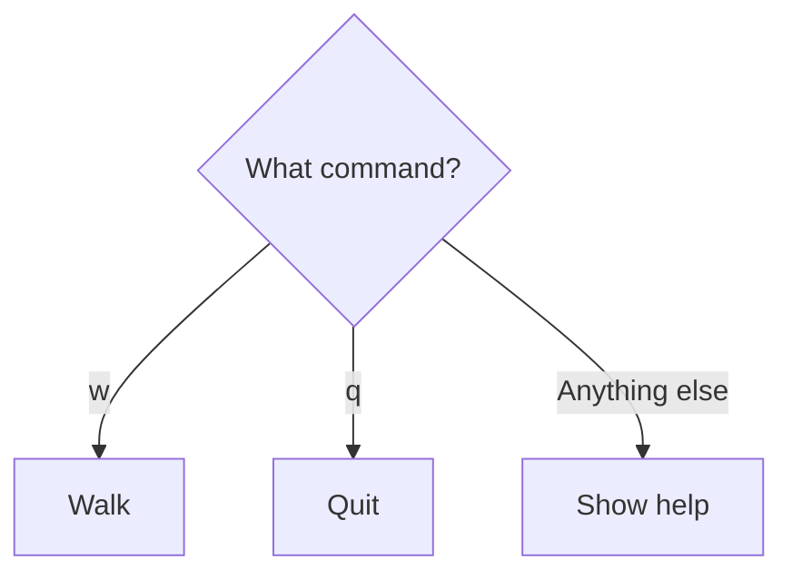

# 06 — Choose an action

CLI foundations. Work in short sessions; a lesson is a learning unit, not one uninterrupted talk.

## Before you begin

05: read and echo a character.

Files: [starter.cpp](starter.cpp) is the runnable starting point.
Keep [target.cpp](target.cpp) for the adult's comparison after the attempt.
The starter runs before any edits; its TRY THIS comment identifies the initial small change.

Use [the common compile/run instructions](../RUN-COMMANDS.md). Copy into Nathan's active
working file rather than overwriting his previous work. Do not ask him to retype
the whole supplied program.

## Follow the picture

## Explain it together

A command is useful when the program can choose what to do with it. A **condition** is a question with a true-or-false answer. An if statement executes its branch when the condition is true.

`command == 'w'` asks whether command currently contains w. The two equals signs compare values. The single equals sign used in assignment changes a value.

An else branch handles a case in which the preceding condition is false. In our if/else-if/else chain, only the first matching branch runs.

## Worked example — predict before running

Read the starter's decision as a small table:

| Input | command == 'w' | command == 'q' if needed | Response |
| --- | --- | --- | --- |
| w | true | not reached | Walk |
| q | false | true | Quit |
| x | false | false | Unknown command |

Here “Quit” is only a printed message: this program ends after one command whichever branch runs. Real repetition and stopping arrive next.

## Guided practice

1. Predict the response for each table row before running it.
2. Run the program separately for w, q, and x.
3. Change the unknown-command message to tell the player to use w or q.
4. Make a temporary mistake by comparing to 'a' rather than 'w'. Try w and explain the mismatch.
5. Restore the intended comparison and rerun both a recognised and unrecognised case.

## Independent challenge

Add a response for s using the existing pattern. Decide its message first. Nathan should identify where the new branch belongs, without being given the finished edit.

Ask for a prediction before execution. Offer one hint at a time; do not reveal the
target as the answer to the independent challenge.

## Understanding checkpoint

Nathan can predict an unseen input's branch and add one recognised command while retaining the fallback.

Record three short entries: **My rule; My prediction; What happened.** Save a working
copy and stop before introducing another idea if the explanation is still uncertain.

---

## Instructor answers and troubleshooting

w prints Walk; q prints Quit; x reaches the final else. If the comparison is changed to 'a', w no longer matches the walk branch.

Do not deliberately teach `if (command = 'w')` as a runnable exercise: it changes state and can create confusing accepted code. Explain comparison versus assignment using the intended lines.

A compiler cannot decide whether the game should call w a walk command. That is a rule we check with examples.

### What the comparison target demonstrates

The target improves the fallback. The additional s branch is reserved for independent work.

### Source connection

A: lines 140–148, conditional movement and wall check; simplify away key polling.

A/B/C resolve to exact local filenames in [the reference index](../references.md).
These are teacher references, not student reading prerequisites. The supplied lesson
examples are original small teaching programs; they do not copy the reference's
Windows engine infrastructure.

Next: [07 — Ask again until quit](../07-loops/LESSON.md)

