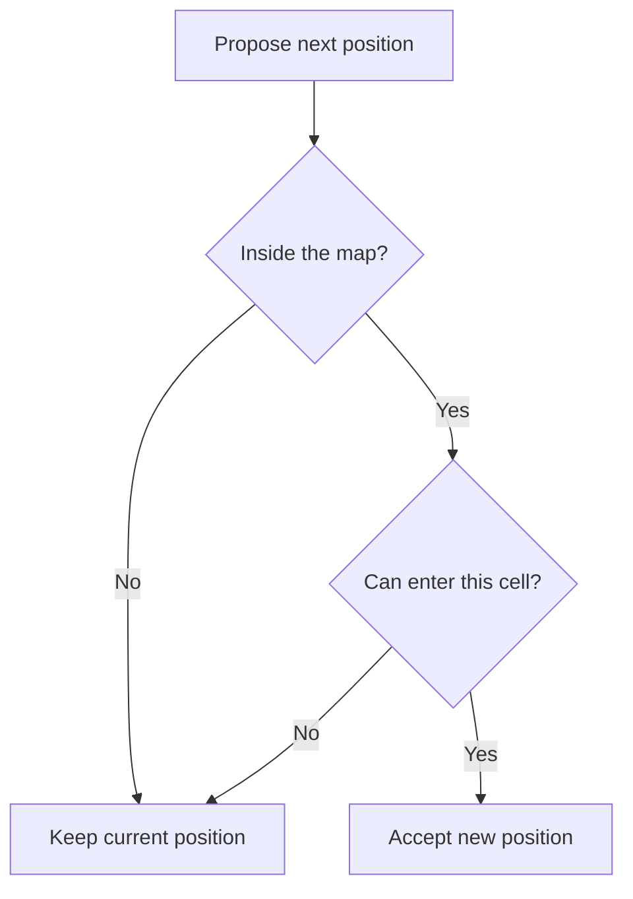

# 12 — Propose, check, accept

CLI foundations. Work in short sessions; a lesson is a learning unit, not one uninterrupted talk.

## Before you begin

11: a boundary function and map query.

Files: [starter.cpp](starter.cpp) is the runnable starting point.
Keep [target.cpp](target.cpp) for the adult's comparison after the attempt.
The starter runs before any edits; its TRY THIS comment identifies the initial small change.

Use [the common compile/run instructions](../RUN-COMMANDS.md). Copy into Nathan's active
working file rather than overwriting his previous work. Do not ask him to retype
the whole supplied program.

## Follow the picture

## Explain it together

A valid movement rule needs two states: the current position and a **proposed** position. We calculate the proposal, check it, and commit it only when allowed.

The order matters. First check whether the proposed indices exist. Only then read the map cell. Short-circuit or early-return structure can enforce this; the starter uses a separate bounds decision before lookup.

A useful property is: if the player begins on walkable floor and every accepted proposal is walkable, the player remains on walkable floor. This is informal correctness reasoning, not a proof notation exercise.

## Worked example — predict before running

Start at (1,1) in the supplied rectangle:

| Command | Proposed position | Cell / condition | Result |
| --- | --- | --- | --- |
| w | (1,0) | wall | stay (1,1), moves 0 |
| d | (2,1) | floor | accept, moves 1 |
| d | (3,1) | wall | stay (2,1), moves 1 |
| s | (2,2) | floor | accept, moves 2 |

The move count counts accepted moves, not all commands. Unknown input also leaves position and count unchanged.

The complete loop is supplied infrastructure assembled from earlier lessons. Explain next_x and next_y first; the drawing code is familiar.

## Guided practice

1. Play the working checkpoint, tracing w,d,d,s on paper first.
2. Identify the current-position variables and the proposal variables.
3. Explain why the wall branch does not need to undo a move.
4. Change the successful-move message only; verify the trace is unchanged.
5. Add a new accepted-move rule in a small separate experiment: the player may enter floor but not a chosen blocked marker.
6. For a bounds demonstration, the adult prepares an open map edge and valid starting floor. Attempt one move outside; it must reject before lookup.

Use a saved copy for map changes. Do not deliberately execute an unchecked lookup.

## Compare a named action with a valid action

Adult-guided source comparison; Nathan does not need to read Rust syntax.
Open D1 (`terminal-fps/src/player.rs`) at lines 25–28, then D2 (`src/main.rs`)
at lines 45–55. Exact filenames are in [the reference index](../references.md).

The port gives coordinate changes a name, move_forward. That operation adds dx
and dy to the player's coordinates. It does not consult the map. The caller in
main performs the wall check afterwards and moves the player back if necessary.

Ask: “Does naming a function move_forward guarantee that the move is allowed?”
No: a name describes an operation, but its implementation and contract establish
what it actually guarantees.

Use our paper example: current position (2,1), proposed position (3,1), where
the map contains a wall. In a move-then-undo approach the position temporarily
changes and is rolled back. In our propose-check-accept approach, the real position
never changes. Both intend to reject this move; the latter keeps invalid state
out of the committed player data and avoids needing rollback.

Small transfer task: explain where a new “door requires a key” condition belongs.
Write one permitted and one rejected example before changing any code. Do not put
the permission check in drawing. For an outside proposal, check bounds before
reading the cell; the port's movement lookup does not explicitly do so.

Instructor answer: permission belongs in the validation rule before committing
the proposed position. The data-update operation alone cannot decide whether a
wall or locked door is enterable. Nathan can explain this in C++ terms without
learning Rust or changing this lesson's starter.

## Independent challenge

Design a corner that blocks two directions. Predict both blocked moves and one successful alternative. Count accepted moves exactly.

Ask for a prediction before execution. Offer one hint at a time; do not reveal the
target as the answer to the independent challenge.

## Understanding checkpoint

Nathan explains proposal versus current state, predicts blocked and outside moves, and states why accepted moves preserve walkability.

Record three short entries: **My rule; My prediction; What happened.** Save a working
copy and stop before introducing another idea if the explanation is still uncertain.

---

## Instructor answers and troubleshooting

The trace ends at (2,2) with moves equal to 2. After a rejected proposal the old coordinates survive, so no rollback is needed.

The target changes only Moved to Move accepted. It is a behaviour-preserving display edit; the larger rule exercise is student work.

An edge wall and a bounds check are different protections. An enclosed map may hide a missing bounds check, but safe rules should not rely on every future map being perfectly enclosed.

The supplied rectangle is fixed and well-formed; variable row lengths need row-specific validation, as used in lesson 14.

### What the comparison target demonstrates

The teacher target preserves gameplay; use the independent task to assess genuine rule changes.

### Source connection

A: lines 139–161 plus 187–195; course improves move-then-undo and unsafe map access.
Compare D1: 25–28 and D2: 45–55 for the same distinction after player data is grouped.

Lettered references resolve to exact local filenames in [the reference index](../references.md).
These are teacher references, not student reading prerequisites. The supplied lesson
examples are original small teaching programs; they do not copy the reference's
Windows engine infrastructure.

Next: [13 — Finish a game you can explain](../13-complete-text-maze/LESSON.md)

