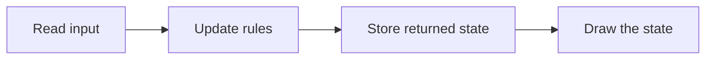

# 14 — Organise without changing the game

CLI foundations. Work in short sessions; a lesson is a learning unit, not one uninterrupted talk.

## Before you begin

13: complete text maze and basic functions.

Files: [starter.cpp](starter.cpp) is the runnable starting point.
Keep [target.cpp](target.cpp) for the adult's comparison after the attempt.
For the actual refactoring exercise, continue Nathan's corrected lesson 13 game; the provided modular program is a comparison checkpoint.

Use [the common compile/run instructions](../RUN-COMMANDS.md). Copy into Nathan's active
working file rather than overwriting his previous work. Do not ask him to retype
the whole supplied program.

## Follow the picture

## Explain it together

As a program grows, we need to know where each rule lives. **Refactoring** changes organisation while preserving intended behaviour.

Separate input, update, and drawing. Input reads a command; update returns the resulting state; drawing displays state. Drawing should not collect a key or increment moves.

The provided comparison groups related fields in a State struct. The grouping syntax and const-reference map parameter are adult-supplied at first. Introduce only what is needed to extract one function; do not turn this into an all-at-once lesson on structs, copying and references.

## Worked example — predict before running

Trace one command through the organised version:

1. main reads d.
2. update receives the map, current State and command.
3. update proposes coordinates and asks can_enter.
4. If allowed, update changes its local state value and returns it.
5. main stores that returned state.
6. draw displays it on the next loop.

`state = update(map, state, command);` matters: update returns a new value. Calling it and discarding the returned value would leave main's state unchanged.

`const Map&` lets a function read the shared map without making a full copy or changing its contents. State is passed by value deliberately so that the update's result is explicit.

## Guided practice

1. Save lesson 13's corrected checkpoint.
2. Record the state after d,s,d,d,w,r and q.
3. Starting from that checkpoint, extract drawing into a function. Compare the same state trace.
4. Extract the movement decision in another session. Compare again.
5. Use target.cpp as an adult structural comparison only after Nathan's first extraction.
6. Change only the displayed player glyph. Explain why movement results should remain identical.

The supplied modular example has quieter feedback messages than lesson 13. Exact text is not an identical-output reference; compare gameplay state. A strict refactor of Nathan's version should preserve its messages too.

## Optional revisit: separate files

Functions can live in different source files. Revisit section 3 of the
[visual primer](../VISUAL-GUIDE.md) to compile two object files and link them.
This is a separate small experiment; preserve Nathan’s working maze.

## Compare the original FPS with its Rust port

Use one later 20-minute session for this comparison after Nathan has extracted
one familiar function. This is an exercise in organisation, not a Rust lesson.

Open A (`CommandLineFPS.cpp`) at lines 83–85 and 140–148. Then open D1
(`terminal-fps/src/player.rs`) at lines 2–6 and 25–40. Ask Nathan to find the same
ideas: position, facing, moving and turning. The adult identifies the Rust names;
Nathan explains their roles using the C++ he already knows.

| Question | Original C++ FPS | Rust port | Our C++ maze |
| --- | --- | --- | --- |
| Where is player state? | Separate global coordinates and angle | One Player record in player.rs | Fields in State |
| Who changes coordinates? | Expressions inside main | Named Player movement operations called by main | update returns a new State |
| Who decides whether movement is legal? | Collision code in main | Collision code in main, outside Player | can_enter before state is changed |
| Who draws? | Rendering and display code in main | Rendering and display still largely in main | draw reads state without changing it |

The port improves how player data and operations are named. It does not yet
separate every responsibility. A smaller main is a consequence of good boundaries,
not a goal achieved by moving arbitrary lines into a file called utils.

### Trace one operation

Start with a forward command and answer these questions, pointing to the code:

1. D2, lines 35–44: where is the command recognised?
2. D2, lines 45–48 and D1, lines 25–28: where is displacement applied?
3. D2, lines 49–55: who knows about walls and performs rollback?
4. D2, lines 173–179 and 194–203: where is the resulting player position displayed?

Now trace our update and draw calls for the same kind of command. Predict the
accepted and blocked cases from the existing maze examples. Explain how a function
that returns state differs from an operation that changes an existing Player.
Neither spelling by itself establishes correctness; check the responsibility and
the concrete before/after values.

### Design file boundaries on paper

Give each job a home before creating any extra source files:

| Job | Possible C++ home | Should not do |
| --- | --- | --- |
| Describe player values | player.hpp | Read keyboard or draw |
| Ask about map cells | map.hpp / map.cpp | Choose terminal colours |
| Validate and apply gameplay movement | movement.cpp | Print the screen |
| Convert world state to a picture | renderer.cpp | Collect keys or award moves |
| Read keys and display/restore terminal | terminal.cpp | Decide whether a door is unlocked |
| Connect the parts | main.cpp | Duplicate every subsystem's rules |

This is a possible later layout, not a new required framework or files supplied
by this lesson. Keep the current single-file working game while learning the
boundaries. Move one understood function to a separate file only when ready;
use the linking experiment from the visual guide and preserve the command trace.

Instructor answers: the port's Player operation owns coordinate arithmetic but
not collision policy. Our can_enter owns the permission decision. Extracting draw
must leave the route, key, win and reset states unchanged. Rendering twice should
not cause two moves. These observations are better evidence than a larger file count.

## Independent challenge

Point to where a future locked-door rule belongs. Then point to where a colour or text change belongs. Give a reason for each without implementing both.

Ask for a prediction before execution. Offer one hint at a time; do not reveal the
target as the answer to the independent challenge.

## Understanding checkpoint

Nathan explains input → update → state → drawing, extracts one familiar operation, and checks that recorded state transitions remain the same.

Record three short entries: **My rule; My prediction; What happened.** Save a working
copy and stop before introducing another idea if the explanation is still uncertain.

---

## Instructor answers and troubleshooting

After the winning route: x=4, y=1, moves=5, has_key=true, won=true. After r: x=1, y=1, moves=0, has_key=false, won=false. Both organised and corrected monolithic versions should match.

The provided checkpoint is an adult reference, not an assignment to retype a complete new architecture. The marked starter comment asks for explanation rather than a fake missing feature. The actual work is extracting one function from the student's saved version.

If drawing changes state, calling draw twice can alter the game. That is evidence of mixed responsibilities.

### What the comparison target demonstrates

Starter and target implement the same modular reference. The intended student artefact is a small refactor of their own lesson 13 checkpoint, not a copied target file.

### Source connection

A: line 90 onward, large main; C: input/logic/presentation sections (see references).
D1: lines 2–40, Player data and operations; D2: 35–75 and 173–203, input,
validation and display that remain in main. D3: 3–45, mixed configuration/map/style data.

Lettered references resolve to exact local filenames in [the reference index](../references.md).
These are teacher references, not student reading prerequisites. The supplied lesson
examples are original small teaching programs; they do not copy the reference's
Windows engine infrastructure.

Next: [15 — Distance depends on time](../15-real-time-movement/LESSON.md)

