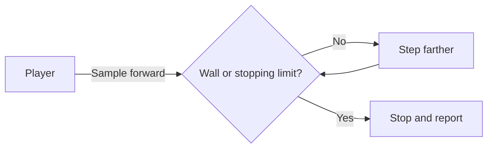

# 17 — Ask what is ahead

Optional depth lab after CLI foundations. These portable console experiments isolate ideas for a later raylib or console-rendering implementation.

## Before you begin

16: position, direction and repeating a calculation.

Files: [starter.cpp](starter.cpp) is the runnable starting point.
Keep [target.cpp](target.cpp) for the adult's comparison after the attempt.
The starter runs before any edits; its TRY THIS comment identifies the initial small change.

Use [the common compile/run instructions](../RUN-COMMANDS.md). Copy into Nathan's active
working file rather than overwriting his previous work. Do not ask him to retype
the whole supplied program.

## Follow the picture

## Explain it together

A **ray** begins at a point and follows a direction. At distance d along it, its position is origin + direction × d. We can sample points along that path until we encounter a wall.

This method approximates an intersection by repeated steps. A smaller step generally needs more map queries and locates the hit more precisely. It is not the same as exact grid intersection.

Before every map lookup, the supplied helper checks the row and column. It uses floor, which maps -0.2 to -1. Casting -0.2 directly to int would produce 0, hiding an outside coordinate.

## Worked example — predict before running

Start at (1.5,1.5) facing east, direction (1,0), in a map whose right wall occupies column 6. The wall begins at x=6.0.

| Sample distance | x | Cell |
| --- | --- | --- |
| 0.00 | 1.50 | floor |
| 0.25 | 1.75 | floor |
| 0.50 | 2.00 | floor |
| … | … | … |
| 4.50 | 6.00 | wall |

Because this helper samples the origin, there are 19 samples from 0 through 4.5 at intervals of 0.25. That count is distance/step + 1 here. The original FPS increments before checking, so its sample-count convention differs.

## Guided practice

1. Trace the first three samples and the final wall sample on graph paper.
2. Run the supplied helper via the starter's single call; do not ask Nathan to type the helper.
3. Halve step from 0.25 to 0.125. Predict 37 samples and the same 4.5 hit distance.
4. Move the start to x=1.6. Compare exact wall distance with the stepped reported distance.
5. Explain all stops: wall, leaving the map, and maximum distance.

The helper assumes a unit direction, finite inputs, step > 0 and limit > 0. These are its contract, not validated user input.

## Independent challenge

Cast west from (1.5,1.5) and predict its wall distance. Then cast across an open-edge map and explain why “no wall” is a distinct answer.

Ask for a prediction before execution. Offer one hint at a time; do not reveal the
target as the answer to the independent challenge.

## Understanding checkpoint

Nathan traces samples, states the stopping conditions and explains measured distance as approximate rather than magically exact.

Record three short entries: **My rule; My prediction; What happened.** Save a working
copy and stop before introducing another idea if the explanation is still uncertain.

---

## Instructor answers and troubleshooting

East at step .25 reports wall true, distance 4.5, samples 19. The target step .125 reports distance 4.5, samples 37.

West reaches column 0 at x below 1.0; exact boundary distance is 0.5, while sampling and boundary inclusion can report a later point depending on step. For this floor-based representation, x=1.0 is still floor, so .25 stepping reports .75. Discuss this rather than promising an exact .5 result.

A ray's no-wall result must not be rendered as an actual wall. DDA is a later alternative after the stepping model is understood.

### What the comparison target demonstrates

The target halves step; the ray direction and world remain unchanged.

### Source connection

A: lines 169–198. Source corner-highlighting at 200–226 is deferred; book §§2.2 and 3.3 are adult background.

A/B/C resolve to exact local filenames in [the reference index](../references.md).
These are teacher references, not student reading prerequisites. The supplied lesson
examples are original small teaching programs; they do not copy the reference's
Windows engine infrastructure.

Next: [18 — Turn distance into a wall column](../18-wall-projection/LESSON.md)

