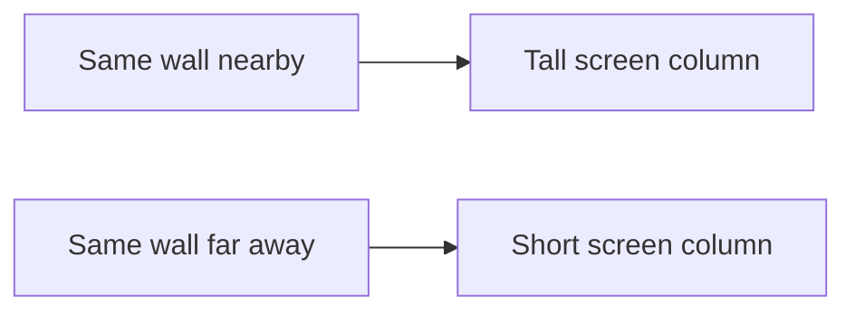

# 18 — Turn distance into a wall column

Optional depth lab after CLI foundations. These portable console experiments isolate ideas for a later raylib or console-rendering implementation.

## Before you begin

17: measured distances; practise ratios first.

Files: [starter.cpp](starter.cpp) is the runnable starting point.
Keep [target.cpp](target.cpp) for the adult's comparison after the attempt.
The starter runs before any edits; its TRY THIS comment identifies the initial small change.

Use [the common compile/run instructions](../RUN-COMMANDS.md). Copy into Nathan's active
working file rather than overwriting his previous work. Do not ask him to retype
the whole supplied program.

## Follow the picture

## Explain it together

A wall of fixed world height appears smaller when farther away. We need a relationship between world distance and screen size.

For this lab, projected height = 8 / distance, rounded down to an integer and restricted to the available screen height. The value 8 is a chosen projection scale, not a universal physical constant.

We protect the calculation with a positive near distance. Division by zero is not a meaningful projection. Clamping to screen height keeps drawing indices valid.

## Worked example — predict before running

With scale 8:

| Distance | Unclamped height | Lab height on 12 rows |
| --- | --- | --- |
| 1 | 8 | 8 |
| 2 | 4 | 4 |
| 4 | 2 | 2 |
| 0 | invalid division | 12 after near clamp and height clamp |

At distance 2, height is 4. top = (12 - 4) / 2 = 4. Draw the wall on rows 4,5,6,7, exactly four rows. The lab uses a half-open interval: top <= row < top + height.

Far positive distances are clamped to at least one row in this demonstration. That is a chosen visibility policy, not physically exact.

## Guided practice

1. Fold or mark a 12-row paper strip. Draw a four-row wall centred in it.
2. Predict the starter's twelve characters and final height message.
3. Double distance to 4 and predict two wall rows.
4. Try distance zero; point to the near-distance protection.
5. Change the scale while keeping distance fixed; explain the larger or smaller projection.

Teach integer rounding separately if the scale does not divide evenly by distance.

## Independent challenge

Choose a positive distance that makes the wall eight rows tall. Then choose a distance that would exceed the screen without clamping.

Ask for a prediction before execution. Offer one hint at a time; do not reveal the
target as the answer to the independent challenge.

## Understanding checkpoint

Nathan explains inverse distance, identifies screen rows versus world units, and counts the exact wall rows without an off-by-one error.

Record three short entries: **My rule; My prediction; What happened.** Save a working
copy and stop before introducing another idea if the explanation is still uncertain.

---

## Instructor answers and troubleshooting

The original draws four # rows; the target draws two. At distance 1 the height is 8. At distance .5 the raw height is 16, clamped to 12.

The near clamp .25 is appropriate only as this lab's chosen policy. A renderer might instead clip geometry against a near plane.

A one-column lab does not yet explain which distance measure to use for off-centre rays. That arrives in the next lesson.

### What the comparison target demonstrates

The target doubles distance from 2 to 4.

### Source connection

A: lines 231–251; supplied formula is simplified projection and needs near-distance handling.

A/B/C resolve to exact local filenames in [the reference index](../references.md).
These are teacher references, not student reading prerequisites. The supplied lesson
examples are original small teaching programs; they do not copy the reference's
Windows engine infrastructure.

Next: [19 — Build a view from columns](../19-first-person-view/LESSON.md)

