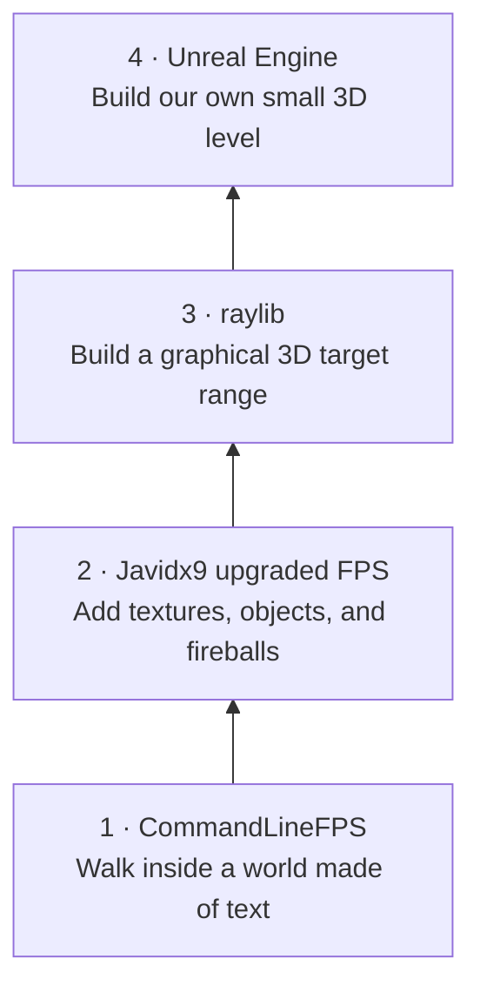
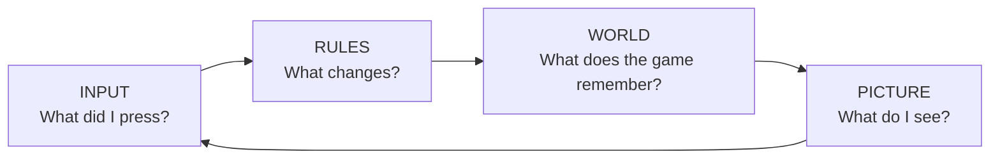
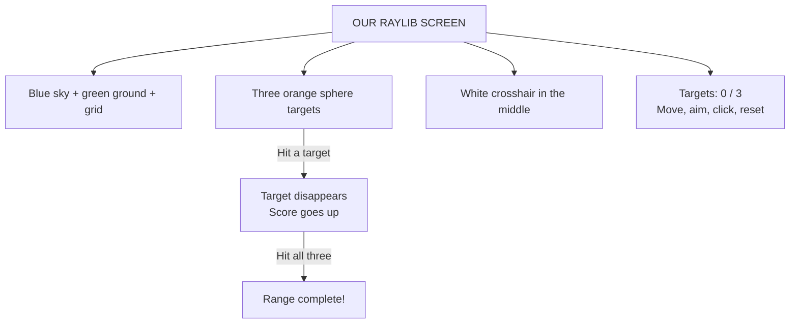

# See where we’re going

**Same ideas. Each time around, we build something richer.**

At every level, we return to the same loop:

## 1. CommandLineFPS — “I can walk inside text!”

**[WATCH THE ORIGINAL DEMO](https://www.youtube.com/watch?v=xW8skO7MFYw)**

**Look for:** chunky shaded walls, a little map, walking and turning.

**Our finish picture:** a small maze we can walk around in first person.
The original is a walking/raycasting demonstration; shooting is not implemented there.

**Ask:** “How could letters and blocks look like a hallway?”

## 2. Javidx9 upgraded FPS — “Now the world has things in it!”

**[WATCH THE UPGRADED DEMO](https://www.youtube.com/watch?v=HEb2akswCcw)**

**Look for:** patterned walls, lamps, fireballs, and objects hidden behind walls.

**Our finish picture:** upgrade a familiar ray-cast world with pictures and moving objects.

**Ask:** “What is still the same maze idea? What new information does a lamp need?”

This means the **upgraded FirstPersonShooter example** inside the Javidx9 collection,
not every project in that repository. Both of these first two demos are by Javidx9.

## 3. raylib — “I can make my own graphical 3D game!”

**[PLAY A FIRST-PERSON MAZE IN YOUR BROWSER](https://www.raylib.com/examples/models/loader.html?name=models_first_person_maze)**

This official raylib example shows the graphical first-person feel. It is a reference
demo, not Nathan’s exact project. Use the controls shown by the demo; press Escape
to release the pointer if captured.

**Our actual project:** [the supplied target range](../src/main.cpp).

This is a **screen guide derived from the source**, not a captured screenshot.
Run the local target range to show its exact final appearance; use the build instructions
in the [project README](../README.md).

**Ask:** “We already know position, movement, and hits. Which jobs does raylib now do for us?”

## 4. Unreal — the next horizon

**Our future goal:** a small first-person level with a target, a score, and a reset.
Start by moving one familiar interaction into the engine. Art, lighting, and sound
can grow later. This course does not yet contain an Unreal project.

**Ask:** “Where do our familiar rules live when an engine manages the world?”

## Show first, then zoom in

1. Show a short gameplay section from each of the first three stages. Skip the code lesson for now.
2. Ask Nathan to name one thing that stays the same and one thing that gets richer.
3. Begin [lesson 00 — Compile and run](00-compile-and-run/LESSON.md), then lesson 01. Return to the [visual guide](VISUAL-GUIDE.md) as needed.
4. Before each new pass, show its destination again. Build one small piece at a time.

The video images are online thumbnails, not local screenshots. If images do not load,
the **WATCH** links still open the demonstrations. Internet is required for those links
and the browser demo. A verified local build is the offline alternative.

---

## Adult reference and readiness

| Pass | Local reference | What is already available? |
| --- | --- | --- |
| CommandLineFPS | `~/repositories/game/CommandLineFPS/CommandLineFPS.cpp` | Windows reference source; its header links the original demo. |
| Javidx9 upgraded FPS | `~/repositories/game/Javidx9/ConsoleGameEngine/BiggerProjects/FirstPersonShooter/OneLoneCoder_ComandLineFPS_2.cpp` | Windows engine example and sprite assets; not a turnkey macOS executable. |
| raylib | `src/main.cpp` in this edu project | Adult-supplied target range, not yet the student’s maze port. |
| Unreal | Future project | Goal only; no implementation supplied yet. |

The Javidx9 filename really spells `Comand`. Its loader expects `FPSSprites/`;
the local sprites are alongside the source. An adult must set up the expected runtime
asset paths and engine include path before a Windows demonstration.

The first two video URLs are taken from the local source headers. The raylib link is
from the official examples site. No local execution of those Windows references is
claimed. The existing 24 checkpoints are small teaching labs; they do not already
constitute the two complete console games.
