# Visual C++ primer

**Lesson 00:** [Compile and run](00-compile-and-run/LESSON.md) uses these charts to teach the first build. Use sections 1–2 to picture how a program is built. Point, predict, then run. Revisit section 3 after functions; the remaining sections are visual reminders for later lessons, not one long first lesson.

Continue with [the structured course](COURSE-INDEX.md). The text maze is the first stepping stone toward CommandLineFPS, then the Javidx9 upgrade, raylib, and Unreal. [See the destinations](START-HERE.md).

These Terminal examples are for the adult’s Mac. Use [adult compiler setup](00-compile-and-run/ADULT-SETUP.md) for Nathan’s Windows compiler. The diagram ideas apply on both platforms.

**Reading key:** Diagrams explain; follow the arrows. **C++ CODE** goes in a `.cpp` file. **TERMINAL** commands go in Terminal.

## 1. Give the computer instructions

C++ is a language for writing instructions.

**DIAGRAM — Write, build, and run**

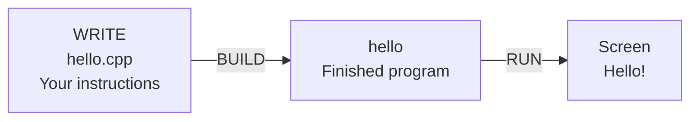

Save this as **hello.cpp**:

**C++ CODE — type in your source file**

```cpp
#include <iostream>

int main() {
    std::cout << "Hello!\n";
    return 0;
}
```

**DIAGRAM — Parts of your first program**

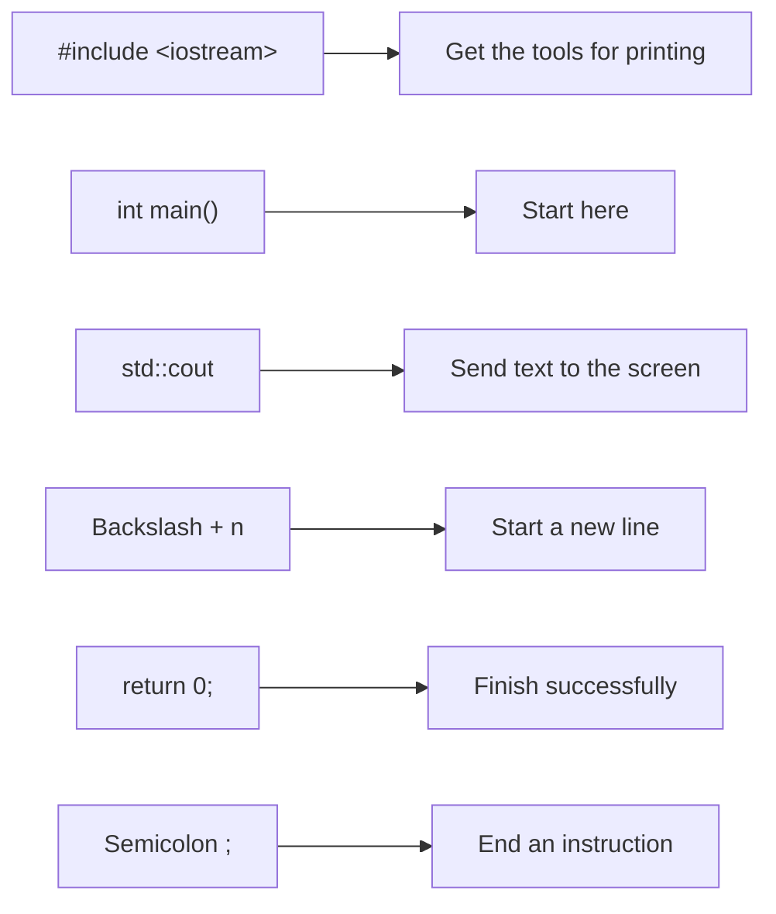

In Terminal, inside the folder containing your file:

**TERMINAL — type these commands in Terminal**

```sh
clang++ hello.cpp -o hello
./hello
```

**DIAGRAM — Reading a Terminal command**

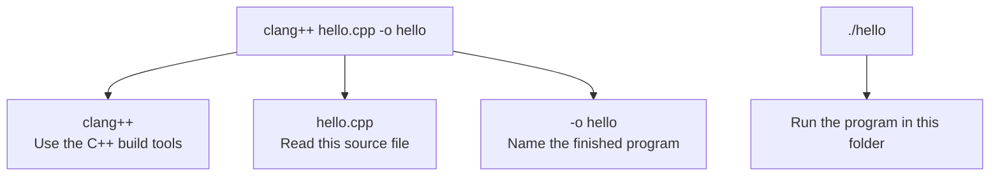

**Try it:** Change `Hello!` to your name. Build again, then run.

*Adult setup help: if the Mac has no compiler, run `xcode-select --install` and finish the installer.*

## 2. What is an object file?

Think of building a toy car:

**DIAGRAM — Building a toy car**

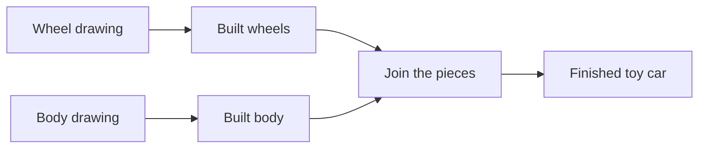

A program is built in pieces too:

**DIAGRAM — Compiling and linking a program**

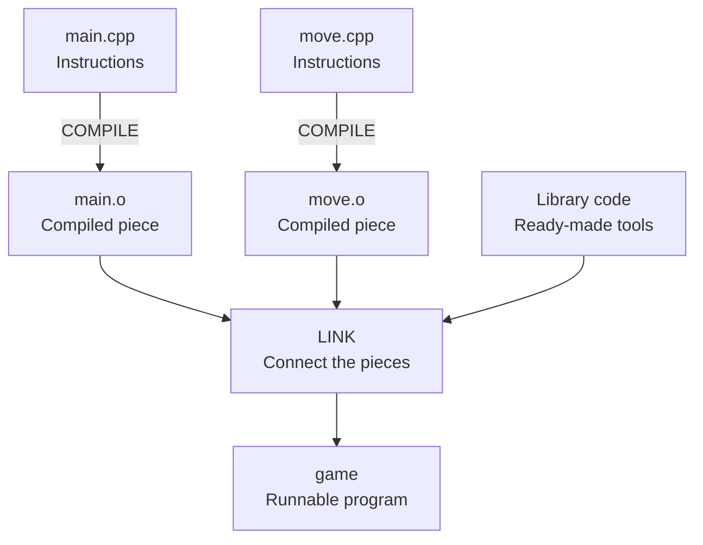

**Compile:** translate C++ into machine-code pieces.  
**Object file (`.o`):** a compiled piece, usually not runnable by itself.  
**Link:** connect the pieces and required library code into a program.

An object file also keeps a list of what it provides and what it needs.

**DIAGRAM — Connecting a function call**

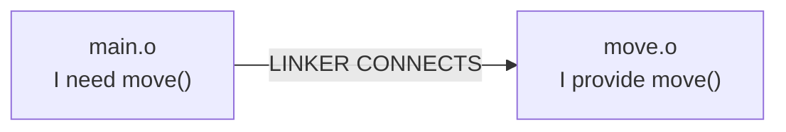

### Build your greeting in two steps

**TERMINAL — type these commands in Terminal**

```sh
clang++ -c hello.cpp -o hello.o
clang++ hello.o -o hello
./hello
```

**DIAGRAM — Compile, link, and run**

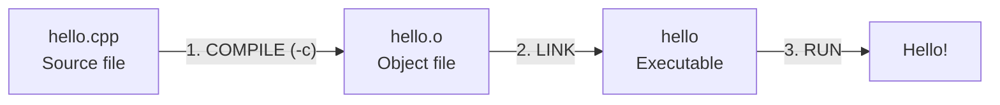

**Point to it:** Which file is a piece? Which file can you run?

## 3. Watch the linker connect two pieces

Make these two files in the same folder.

**main.cpp**

**C++ CODE — type in your source file**

```cpp
#include <iostream>

int move(int position); // Promise: this function exists somewhere.

int main() {
    std::cout << move(2) << "\n";
    return 0;
}
```

**move.cpp**

**C++ CODE — type in your source file**

```cpp
int move(int position) {
    return position + 1;
}
```

**DIAGRAM — Connecting two source files**

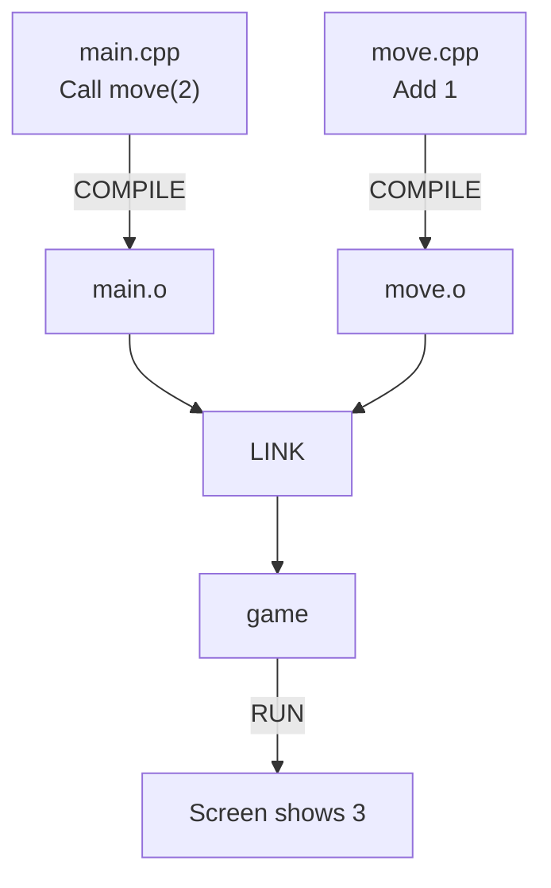

**TERMINAL — type these commands in Terminal**

```sh
clang++ -c main.cpp -o main.o
clang++ -c move.cpp -o move.o
clang++ main.o move.o -o game
./game
```

**Break it on purpose:** Leave out `move.o`:

**TERMINAL — type these commands in Terminal**

```sh
clang++ main.o -o broken-game
```

**DIAGRAM — A missing piece causes a link error**

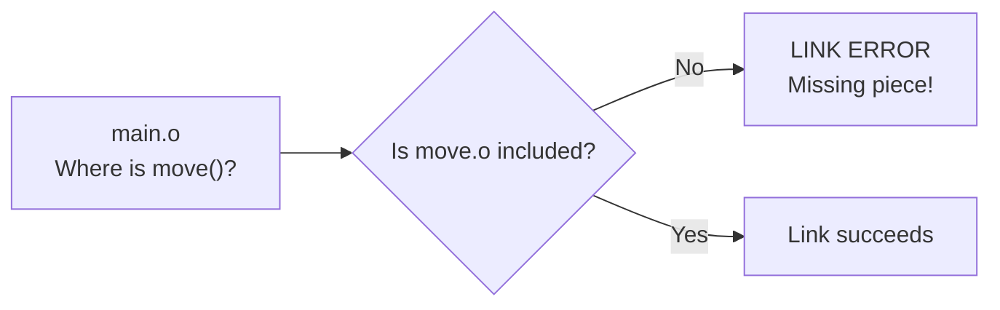

**Fix it:** Link both object files again.

## 4. Variables are labeled boxes

A variable stores a value. Its type says what kind.

**C++ CODE — type in your source file**

```cpp
int health = 100;
double x = 2.5;
bool playing = true;
char wall = '#';
```

**DIAGRAM — Variables store values**

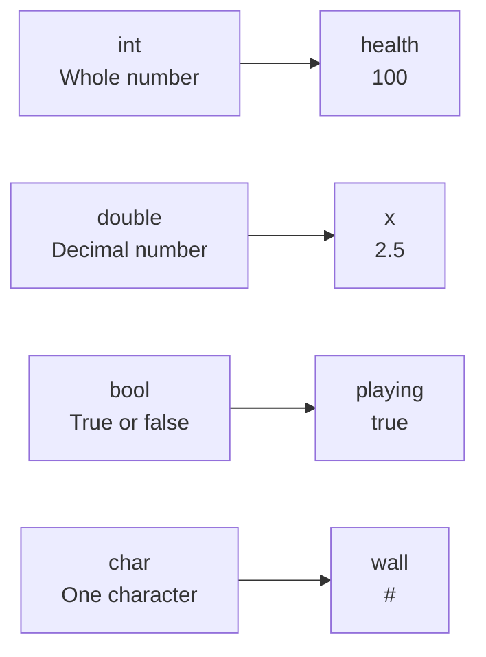

**C++ CODE — type in your source file**

```cpp
health = health - 10;
```

**DIAGRAM — Updating health**

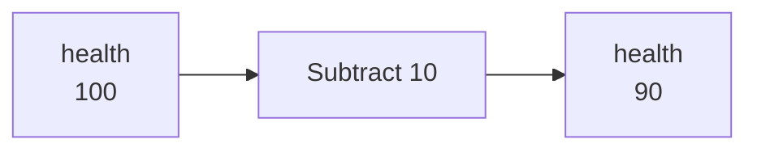

**Try it:** Start at `100`. Take damage twice. What is in the box?

## 5. Decisions choose a path

**C++ CODE — type in your source file**

```cpp
if (health > 0) {
    std::cout << "Keep playing!\n";
} else {
    std::cout << "Game over!\n";
}
```

**DIAGRAM — Choosing a path**

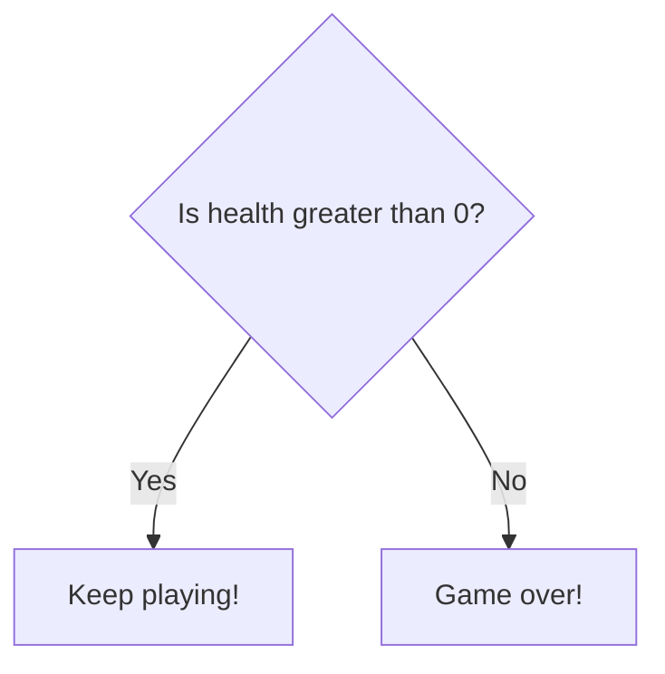

**Trace it:** Follow the arrows with health `20`. Then try `0`.

## 6. Loops repeat instructions

**C++ CODE — type in your source file**

```cpp
int count = 0;
while (count < 3) {
    std::cout << count << "\n";
    count = count + 1;
}
```

**DIAGRAM — Repeating instructions**

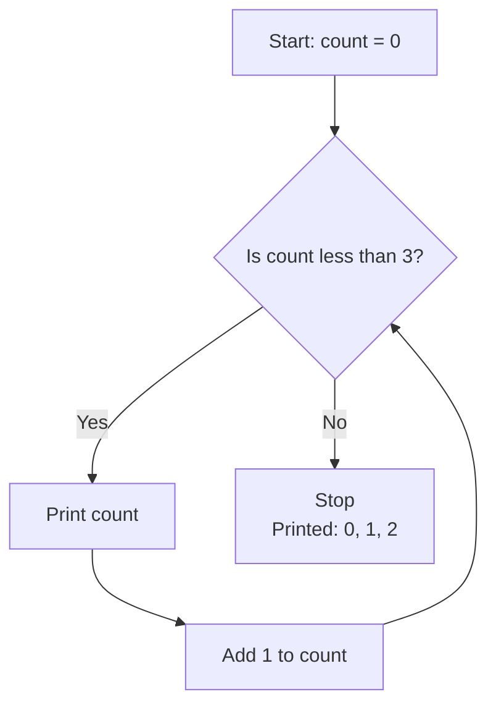

**Predict:** Change `3` to `5`. What will print?

## 7. Functions are little machines

A function takes input, does a job, and can return an answer.

**C++ CODE — type in your source file**

```cpp
int move(int position) {
    return position + 1;
}
```

**DIAGRAM — A function takes input and returns an answer**

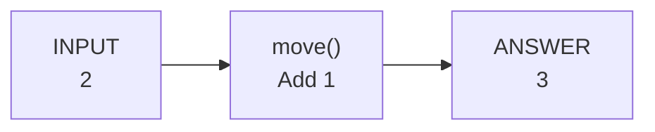

To keep the answer, store it:

**C++ CODE — type in your source file**

```cpp
int x = 2;
x = move(x);
```

**DIAGRAM — Saving a returned answer**

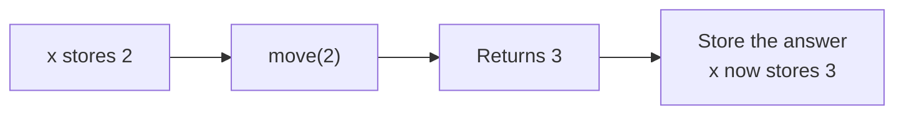

**Try it:** Make `move` add `2`. Recompile `move.cpp`, then link again.

## 8. A game map is a grid

| y ↓ / x → | 0 | 1 | 2 | 3 | 4 | 5 | 6 | 7 |
| --- | --- | --- | --- | --- | --- | --- | --- | --- |
| 0 | # | # | # | # | # | # | # | # |
| 1 | # | . | **P** | . | . | . | . | # |
| 2 | # | . | . | . | # | . | . | # |
| 3 | # | # | # | # | # | # | # | # |

**# = wall · . = empty · P = player**

**DIAGRAM — Map coordinates**

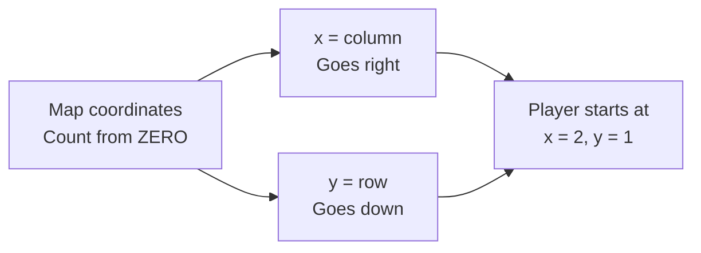

**DIAGRAM — Checking a move**

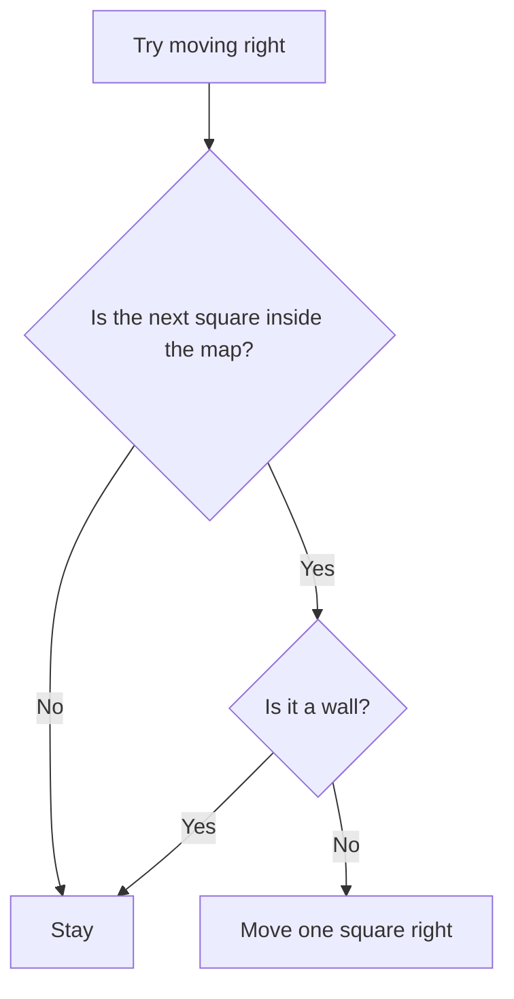

**Point to it:** Where is the player after one move right?

Always check that a square is inside the map before reading it.

## 9. How does the map become a first-person view?

Imagine shining a thin flashlight beam from the player.

**DIAGRAM — Casting a ray**

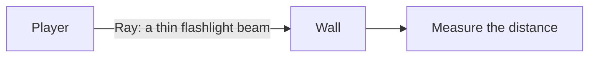

Measure how far away the wall is. Nearby walls look taller.

**DIAGRAM — Near and far walls**

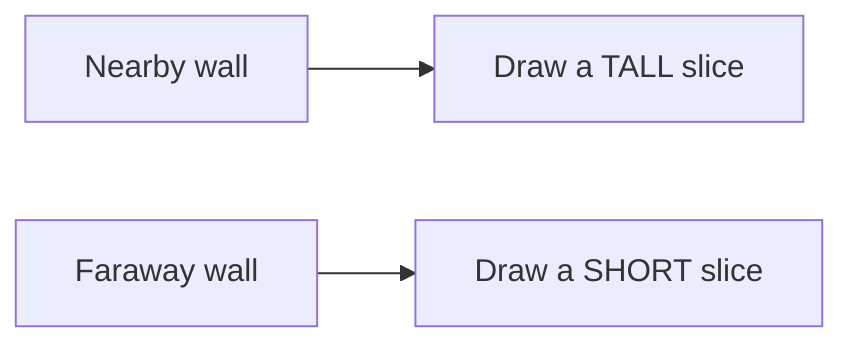

Many beams give us many screen columns. Together, they form the view.

**DIAGRAM — The game loop**

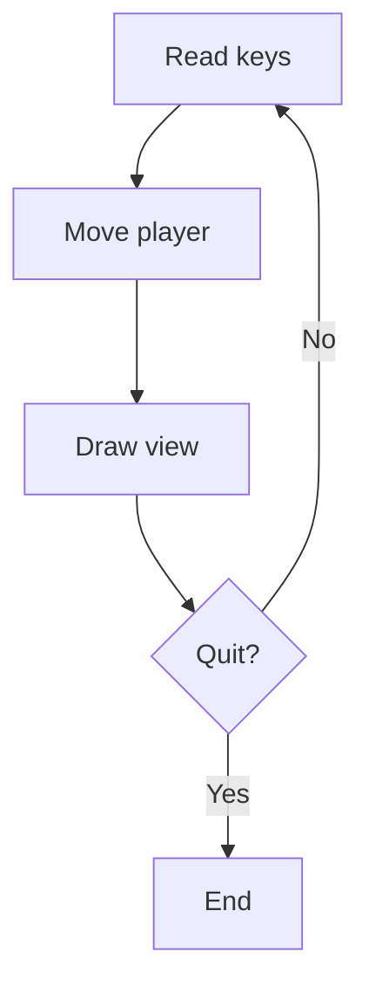

## 10. Your mission checklist

- [ ] Print your name using C++.
- [ ] Point to the source file, object file, and executable.
- [ ] Explain linking by pointing to the two pieces it connects.
- [ ] Fix the missing-piece link error.
- [ ] Predict a variable's new value.
- [ ] Follow a decision and a loop with your finger.
- [ ] Move the player one square on the map.

**Next mission:** return to [your current lesson](COURSE-INDEX.md); after the first primer session, start [lesson 01](01-first-program/LESSON.md).

---

*Teaching note: code in lessons 4–6 belongs inside `main`, after including `<iostream>`. Teach one section at a time: point → predict → run. Terminal controls and precise wall-distance calculations come in later lessons.*
